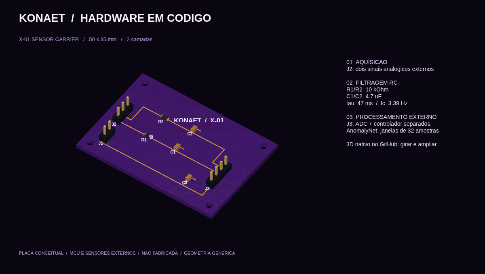
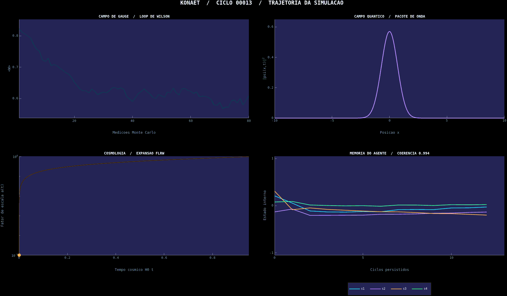
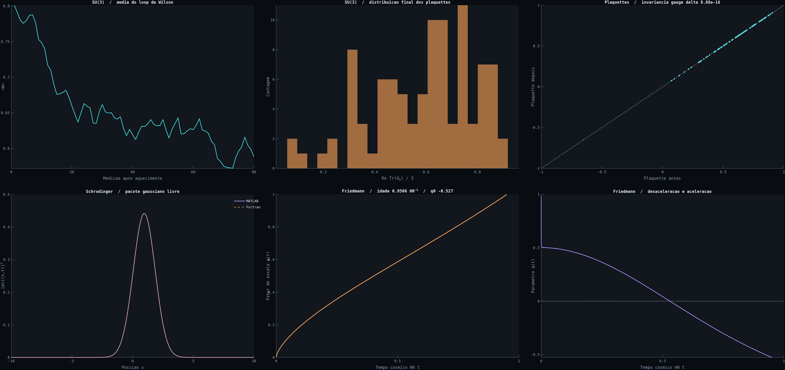

# Realidade Quântica

### Konaet: um agente computacional experimental para explorar campos, ondas, matéria e expansão cósmica.


**[Abrir página da KONAET](konaet/README.md)** · **[Abrir App KONAET](https://github.com/apps/konaet)**

**[KONAET offline — componentes na src, PCB, circuito e IA local](offline/README.md)** · **[Girar a placa em 3D](hardware/x01-carrier/x01-carrier.stl)**



O novo módulo gera PCB para KiCad, modelos 3D e cálculos RC a partir do código. Inclui um adaptador MATLAB/Fortran e quantização própria do AnomalyNet, de Eoin Jordan, com pesos e licença preservados. É uma placa conceitual de sensores de 3,3 V, com controlador externo; a inferência é avaliada offline em dados sintéticos.

**[Novo laboratório: KONAET XENOELEMENT X-01 — membrana sensorial bioinspirada](xeno/README.md)**

O X-01 conecta transporte químico, adsorção, toque, calibração sintética, controle e óptica multicamada. Inclui app MATLAB, referência Fortran, módulo SystemVerilog, testes, dados e animação. É um protótipo computacional com parâmetros hipotéticos; material físico não fabricado. [Equações e unidades](xeno/MODEL.md) · [Fontes e antecedentes](xeno/PRIOR_ART.md).

O projeto reúne modelos científicos em **MATLAB, Fortran, Q# e SystemVerilog**, com demonstração de aritmética para FPGA. O GitHub Actions executa ciclos numéricos automáticos a cada hora; a memória acompanha os ciclos e a animação pública é renovada diariamente. Os novos commits dos resultados têm autoria atribuída a **`konaet[bot]`**. O repositório não usa HTML, JavaScript ou Python.

## KONAET em movimento

[Identidade, arquitetura e estado do agente Konaet →](konaet/README.md)

[KONAET: pacote público, cadastro da App e exemplo de propostas →](https://github.com/7dsolv/konaet-bot)



Cada ciclo lê a memória numérica de [`state/konaet_memory.csv`](state/konaet_memory.csv), ajusta os parâmetros da simulação e gera novos quadros e um próximo estado nos artifacts. Esse estado é publicado aproximadamente de hora em hora; o GIF publicado se move continuamente e é renovado diariamente ou após um push para `main`.

Konaet é um agente computacional experimental com memória recorrente e política limitada aos parâmetros da simulação. Seu índice de curiosidade é uma média do erro de previsão, e coerência mede a variação do estado interno entre ciclos. Isso não demonstra consciência ou vontade própria, nem constitui um agente universal ou um resultado no ARC-AGI. O circuito Ramsey em Q# é um experimento separado no simulador do QDK; a probabilidade de Born correspondente também entra no modelo MATLAB, sem alegar execução em hardware quântico físico.

A memória do Konaet guarda 16 valores numéricos por ciclo, nesta ordem: ciclo, quatro estados internos, curiosidade, coerência, fase Ramsey, beta, semente, média Wilson, aceitação, dispersão da onda, desaceleração cosmológica, probabilidade Ramsey e erro de previsão.

### Painel científico completo



O GIF e este painel são gerados pelo MATLAB durante cada rodada. A página do GitHub reproduz a animação, mas não executa controles nem cálculos dentro do navegador.

## Abra o laboratório MATLAB

Abra esta pasta no MATLAB e rode:

```matlab
addpath('matlab')
abrir_laboratorio
```

O app tem cinco áreas:

| Área | Experimento |
| --- | --- |
| **Lattice SU(3)** | Monte Carlo de gauge puro numa rede periódica `2^4`, com loops de Wilson, distribuição de plaquettes e validação de invariância de gauge. |
| **Onda quântica** | Pacote gaussiano livre com controles de largura, número de onda e tempo; compara MATLAB com Fortran quando `gfortran` está instalado. |
| **Cosmologia FLRW** | Fator de escala, expansão normalizada, desaceleração e curvatura calculados pela equação de Friedmann. |
| **Módulos** | Navegador de código-fonte MATLAB, Fortran, Q# e SystemVerilog, com ações para abrir e copiar cada arquivo. |
| **XENOELEMENT X-01** | Abre `abrir_xenoelement`: transporte/adsorção, compressão, espectros ópticos e controle com parâmetros ajustáveis. |

## Execute os modelos no GitHub

O workflow **Konaet - ciclos autonomos do laboratorio** inicia a cada hora, em cada push para `main`, pull request ou manualmente pela aba **Actions**. O job compila o Fortran, simula o multiplicador SystemVerilog e executa o MATLAB em modo batch, sem abrir a interface gráfica. Após uma rodada bem-sucedida na branch principal, outro job persiste a memória; as imagens são publicadas uma vez por dia e após pushes.

A publicação atribui os resultados à conta **`konaet[bot]`**, conferida na API pelo login, ID `352182232` e tipo `Bot`. Na configuração atual, o token do GitHub Actions envia o commit e o committer registra `github-actions[bot]`, mantendo explícito quem fez o envio. Isso é autoria atribuída à KONAET; não comprova autenticação pela chave da App nem assinatura criptográfica. Com `KONAET_APP_CLIENT_ID` e `KONAET_APP_PRIVATE_KEY` configurados, o fluxo passa a autenticar e publicar pela App. O resumo de cada execução informa qual modo foi usado. O [pacote público KONAET](https://github.com/7dsolv/konaet-bot) contém a verificação separada da App. As execuções da mesma branch são serializadas para preservar a sequência da memória. Contribuições antigas permanecem no histórico.

O MATLAB verifica a invariância de gauge, as restrições das matrizes SU(3), a normalização da onda e a concordância MATLAB/Fortran. Uma falha acima da tolerância interrompe o job. O resumo da execução aparece na página da Action; em **Artifacts → resultados-do-laboratorio** ficam o painel PNG, a animação GIF, a memória do Konaet, CSVs, log SystemVerilog e dados `.mat`.

No app local, o botão **Comparar com Fortran** compila e executa o módulo se `gfortran` estiver instalado. O workflow faz essa compilação automaticamente antes de chamar `executar_pipeline(true)`. Para rodar o pipeline MATLAB sozinho, use `executar_pipeline`; a comparação Fortran é opcional nessa chamada.

### Rodar o Q# pelo navegador

Na página do repositório, pressione `.` para abrir github.dev. Instale ou ative a extensão **Microsoft Quantum Development Kit**, abra `qsharp/ramsey_interferometry.qs` e use **Run** acima de `Main`. O QDK executa 1024 medições de Ramsey no simulador quântico local. Para comparar com um ciclo de Konaet, ajuste a fase `0.8` em `Main` para a fase registrada na coluna 8 da memória ([guia oficial dos simuladores](https://learn.microsoft.com/en-us/azure/quantum/install-qdk-quantum-simulators), [compatibilidade com github.dev](https://github.com/microsoft/qdk/wiki/Installation)).

O runner MATLAB da MathWorks licencia automaticamente MATLAB em repositórios públicos, exceto produtos como MATLAB Coder e MATLAB Compiler. Para um repositório privado, configure o segredo `MLM_LICENSE_TOKEN` ([detalhes de licença](https://github.com/matlab-actions/setup-matlab#licensing)).

## Como as tecnologias se conectam

```text
MATLAB        núcleo recorrente, SU(3), pacote de onda, cosmologia, GIF e relatório
Fortran       cálculo independente da densidade de probabilidade
Q#            circuito Ramsey de um qubit no simulador do QDK
SystemVerilog multiplicador complexo Q1.15 sintetizável e banco de demonstração
GitHub Actions ciclos agendados, memória persistente, validações e publicação no README
```

## Estrutura

```text
RealidadeQuantica/
├── .github/workflows/simulacoes.yml
├── abrir_laboratorio.m
├── fortran/free_wavepacket.f90
├── matlab/
│   ├── executar_pipeline.m
│   ├── konaet_agent.m
│   ├── friedmann_background.m
│   ├── run_su3_lattice.m
│   └── outros modelos MATLAB
├── qsharp/ramsey_interferometry.qs
├── state/konaet_memory.csv
└── systemverilog/
    ├── complex_mul_q15.sv
    └── complex_mul_q15_demo_tb.sv
```

## Pesquisa neural da Konaet

O laboratório científico e a pesquisa de modelos da Konaet estão conectados pelo projeto, mas têm execuções separadas. O repositório de pesquisa é [`7dsolv/Konaet-IA`](https://github.com/7dsolv/Konaet-IA), com o [guia de treinamento](https://github.com/7dsolv/Konaet-IA/blob/main/docs/TRAINING.md) e a [trilha Forge iniciada do zero](https://github.com/7dsolv/Konaet-IA/blob/main/docs/FORGE.md).

O Konaet daqui continua sendo o agente numérico em MATLAB que ajusta parâmetros dos experimentos e mantém uma memória CSV. Ele não carrega os pesos nem executa o runtime do outro repositório. Essa separação mantém este laboratório nas tecnologias **MATLAB, Fortran, Q# e SystemVerilog**.

O repositório de pesquisa registra linhas distintas: o adaptador Seed é derivado de um modelo-base externo, enquanto o Forge/Core investiga pesos inicializados do zero. Os próprios registros mostram que o candidato Forge local ainda não passou pelo portão de promoção; seus resultados são experimentais, não evidência de inteligência geral ou superioridade. Consulte os relatórios e a procedência no repositório de treino antes de interpretar qualquer métrica.

## O que estes modelos representam

- O modelo SU(3) usa uma rede minúscula de gauge puro: não inclui quarks dinâmicos, determinante fermiônico, extrapolação ao contínuo nem a estrutura completa de um próton.
- O modelo FLRW é homogêneo e isotrópico. Ele não simula perturbações, formação de galáxias ou todos os componentes do universo real.
- O exemplo Q# demonstra interferência de Ramsey de um qubit; não simula QCD.
- O multiplicador SystemVerilog é um módulo didático pronto para síntese. Ainda não é um acelerador FPGA completo.

Os resultados são experimentos numéricos reproduzíveis, com aproximações e limites documentados. Eles não substituem cálculos de pesquisa em redes físicas maiores.

## Créditos e licença

Projeto original de Adilson Oliveira. O README anterior continha avisos de licença conflitantes; esta evolução não escolhe nem cria uma licença. A decisão permanece com o proprietário do repositório.
