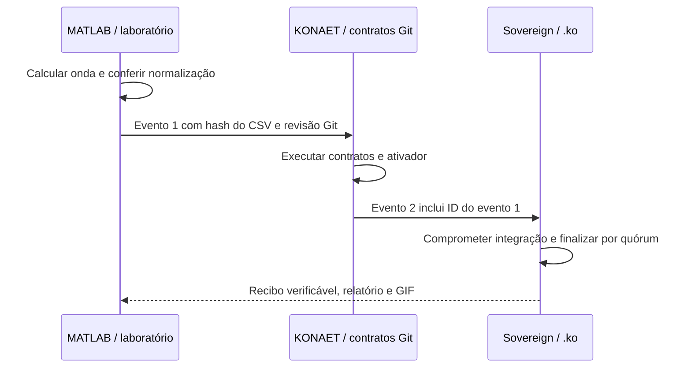

# KONAET — laboratório, automação e recibos

O [workflow do ecossistema](../.github/workflows/ecosystem.yml) calcula um
pacote de onda com o código deste laboratório e executa os contratos Git
e o ativador do [KONAET](https://github.com/7dsolv/konaet-bot). A ponte MATLAB da
[Sovereign Spec](https://github.com/7dsol3/konaet-sovereign-spec/tree/main/ecosystem)
transforma hashes dos resultados em eventos encadeados e em um compromisso
compatível com `SocialReceiptRegistry.ko`.

As revisões dos componentes externos são fixadas por SHA completo. O ID da
execução, a tentativa, o código e o SHA-256 do arquivo entram no evento sem
conversão para números de ponto flutuante. Fontes modificadas sem commit
são recusadas. O contrato é executado e seu recibo conferido em quatro
processos locais; não se anuncia uma rede pública permanente.



O artefato de execução inclui os três eventos, o CSV, os relatórios do bot,
o certificado e o GIF gerado em MATLAB. Na `main`, o workflow também produz
atestados de procedência dos relatórios pela identidade do GitHub Actions.
Essa assinatura de build e a autenticação da App `konaet[bot]` são mecanismos
distintos; esta suíte offline não usa nem declara autenticação da App.

Depois de baixar o artefato, confira a procedência:

```sh
gh attestation verify ecosystem-report.json --repo 7dsolv/RealidadeQuantica --signer-workflow 7dsolv/RealidadeQuantica/.github/workflows/ecosystem.yml
gh attestation verify sovereign-finality.json --repo 7dsolv/RealidadeQuantica --signer-workflow 7dsolv/RealidadeQuantica/.github/workflows/ecosystem.yml
```

Fixe também `--source-digest` à revisão confiável desejada. Para aceitar uma
rede externa, obtenha sua gênese e contrato por canal confiável independente.
Um recibo comprova inclusão e finalização; não certifica a verdade de uma
alegação científica, um ensaio físico ou superioridade geral de inteligência.

O [BTC Lab](https://github.com/7dsol3/konaet-sovereign-spec/tree/main/btc-lab)
é operado separadamente em máquina local, com catálogo público fixado,
limite de tempo e checkpoint. Nenhum módulo deste laboratório tenta acessar
carteiras dormentes ou agenda buscas por recompensas no GitHub Actions.
