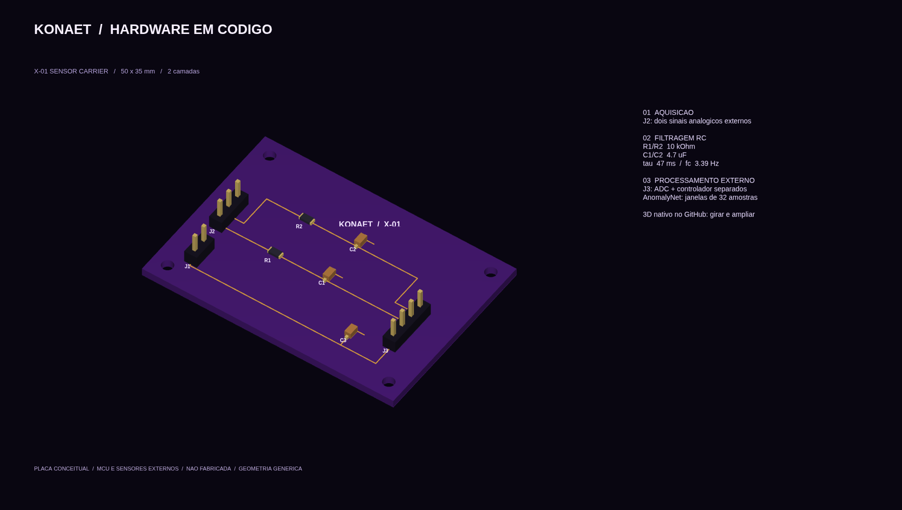
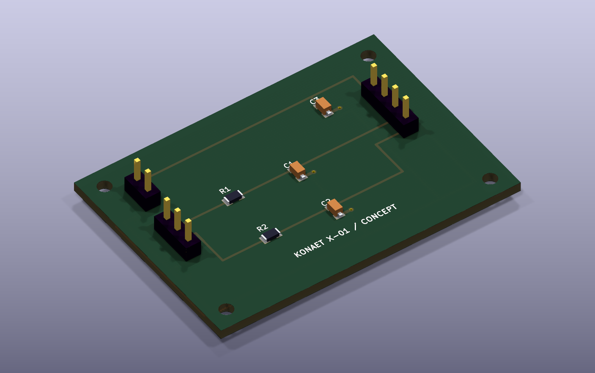

# KONAET / X-01 Sensor Carrier

**[Explorar 3D no GitHub](x01-carrier.stl)** · [Abrir PCB no KiCad](x01-carrier.kicad_pcb) · [Sistema completo e cálculos](../../offline/README.md)

Placa passiva de 3,3 V com dois filtros RC. Os arquivos desta pasta são gerados por [`src/board`](../../src/board). A [BOM](bom.csv) descreve valores genéricos e posições, sem selecionar fabricante. Os modelos em `models/` são envelopes geométricos próprios e aproximados, não modelos CAD específicos de peças comerciais.

Baixe a pasta inteira para preservar os modelos VRML relativos. Abra `x01-carrier.kicad_pcb` no KiCad e entre em **Visualizar → Visualizador 3D**. O STL usa milímetros e inclui os quatro furos de montagem. No GitHub, abra o arquivo para girar e ampliar a montagem.

A imagem acima é calculada pelo renderizador do KiCad 10 durante a validação. O PNG roxo e o GIF são composições MATLAB da mesma descrição de componentes.

Conectores: J1 `+3V3 / GND`; J2 `RAW_L / RAW_R / GND`; J3 `+3V3 / GND / ADC_L / ADC_R`, em ordem crescente de pino. O MCU/ADC, sensores e proteções de entrada são externos. A placa é conceitual e não foi fabricada. Consulte as hipóteses elétricas e limitações no [sistema completo](../../offline/README.md).
