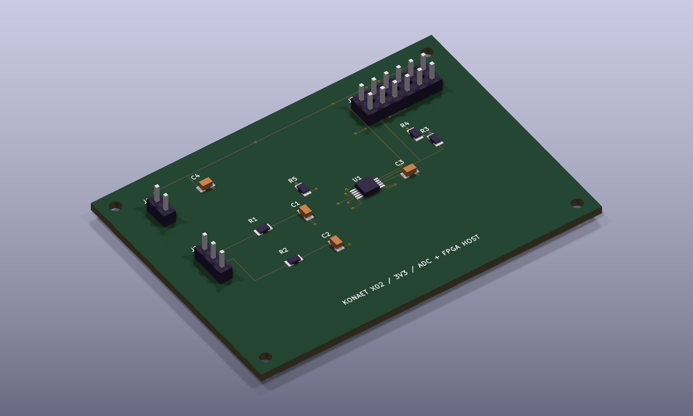

# KONAET / X02 Acquisition

**[Explorar STL em 3D](x02-acquisition.stl)** · [Abrir projeto KiCad](x02-acquisition.kicad_pro) · [Sistema integrado](../../integrated/README.md)

Placa conceitual de **70 × 50 mm, quatro camadas**, alimentada com 3,3 V externos. Inclui ADS1115IDGSR, dois filtros RC, capacitores de desacoplamento, pull-ups I²C e interface Pmod. A FPGA fica no módulo host iCEBreaker, fora desta placa. As duas entradas analógicas são roteadas; o host desta versão utiliza AIN0.

Baixe a pasta inteira para preservar `KONAET.kicad_sym`, `KONAET_X02.pretty`, as tabelas de bibliotecas e os modelos locais. Esquema e PCB são gerados da mesma fonte MATLAB [`konaet_acquisition_board.m`](../../matlab/integrated/konaet_acquisition_board.m). As bibliotecas e envelopes 3D são próprios e aproximados; não representam qualificação mecânica de peças de fabricante.

J2: sinais RAW_L, RAW_R e GND. J3: pinos 1 SCL, 2 SDA, 3 ALERT, 5/11 GND, 6/12 +3V3. Os demais pinos ficam explicitamente não conectados. A numeração segue a interface Pmod; conferir a orientação física do cabo e o desenho do conector antes de qualquer montagem. J1 é ponto de acesso à mesma alimentação externa, não uma segunda fonte independente.

As regras geométricas usadas são largura mínima de trilha de 0,20 mm, clearance de 0,20 mm e vias de 0,60/0,30 mm. Os relatórios completos [ERC](erc.json), [DRC e paridade](drc.json) e a [BOM](bom.csv) permanecem públicos. Passar nessas checagens não garante fabricação, compatibilidade analógica ou comportamento físico.

Fontes primárias: [ADS1115 — Texas Instruments](https://www.ti.com/lit/ds/symlink/ads1115.pdf), [host iCEBreaker](https://github.com/icebreaker-fpga/icebreaker), [conector candidato Samtec](https://www.samtec.com/products/ssw-106-02-g-d), [resistor candidato Yageo](https://www.yageogroup.com/component-documentation/download/specsheet/RC0805FR-0710KL). Os MPNs da BOM são candidatos para revisão, sem afirmação de disponibilidade. ESR, fuga e dependência da capacitância com polarização no simulador são hipóteses, não medições desses componentes.

**Não fabricada. Sem controle térmico ou conexão à rede elétrica.** Consumo e latência física ainda não foram medidos.
