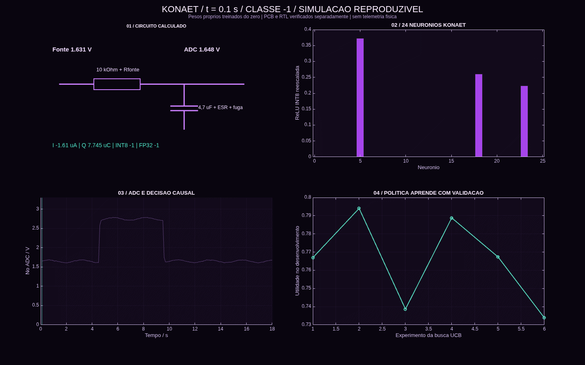
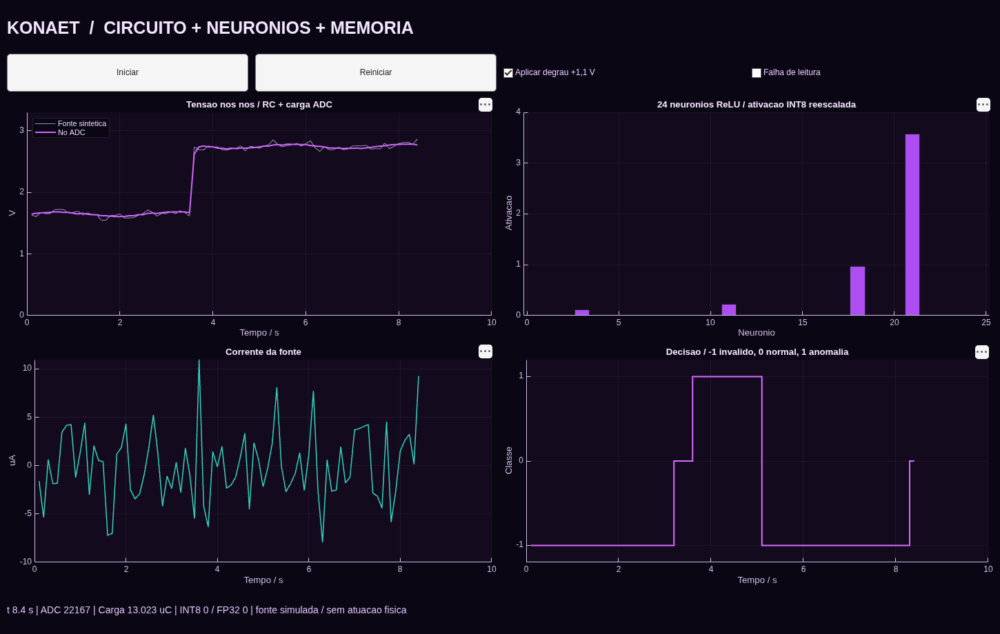
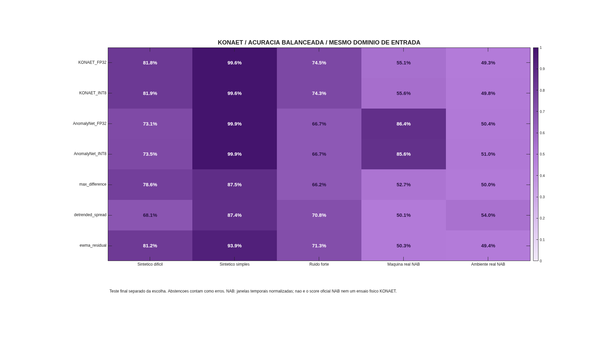
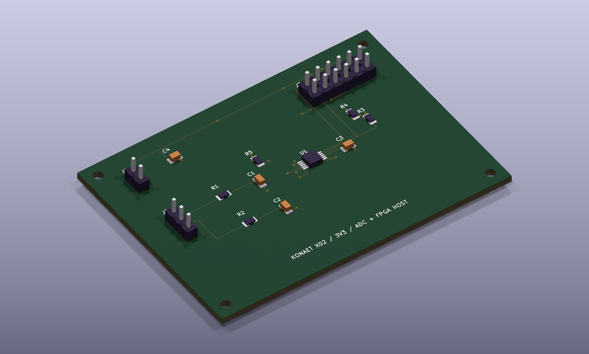

# KONAET / Agente integrado X02

[](https://github.com/7dsolv/RealidadeQuantica/actions/workflows/integrated.yml)
[](https://github.com/7dsolv/RealidadeQuantica/releases/latest)

[Escopo das verificações e conquistas](VERIFICATION.md)

**[Baixar versão atual](https://github.com/7dsolv/RealidadeQuantica/releases/latest)** · **[Explorar placa 3D](../hardware/x02-acquisition/x02-acquisition.stl)** · **[Esquema e PCB](../hardware/x02-acquisition)** · **[Resultados auditáveis](RESULTS.md)** · **[Execuções](https://github.com/7dsolv/RealidadeQuantica/actions/workflows/integrated.yml)**

A KONAET integra uma pesquisa autônoma restrita, detector treinado do zero, inferência INT8 em SystemVerilog, circuito não ideal, ADC e painel MATLAB. O agente escolhe configurações, treina candidatos, mede a validação e persiste suas recompensas para a próxima rodada. Os pesos novos se chamam **KONAET Sense 842**.



O GIF usa os valores calculados de tensão, corrente, carga do capacitor e ativações dos neurônios. Ele reproduz uma execução simulada. No app MATLAB os controles alteram a simulação em execução; o GitHub apresenta os arquivos e o visualizador 3D, sem executar nossa física no navegador.

## Usar agora

Na raiz do projeto, no MATLAB:

```matlab
abrir_konaet
```

O painel permite pausar, reiniciar, aplicar um degrau elétrico e simular falha de leitura. O circuito avança em passos causais; uma janela precisa de 32 amostras antes da primeira classificação. Leitura inválida não é apresentada como normal. A falha deixa de contaminar a janela depois de 32 leituras válidas.



Para classificar seu CSV local, use **uma janela por linha e 32 temperaturas em °C por janela**, no domínio numérico de 10–90 °C:

```matlab
konaet_classificar('janelas.csv', 'artifacts/classificacao.json');
```

Para reproduzir a pesquisa e os gráficos, `executar_konaet`. A checagem Fortran exige compilar `fortran/tiny_anomalynet.f90` em `build/tiny_anomalynet`. As checagens RTL, síntese/roteamento e KiCad são feitas pelas CLIs no workflow. Não há runtime Python, HTML ou JavaScript próprio.

## O que o agente aprende

[`konaet_agent_search.m`](../matlab/integrated/konaet_agent_search.m) executa seis experimentos por rodada. UCB1 escolhe entre três configurações de treinamento. Adam ajusta os 842 parâmetros de uma rede densa padrão `32 → 24 ReLU → 2 logits`, inicializada aleatoriamente, com gradiente analítico MATLAB e sem toolbox de IA. A arquitetura é conhecida; o projeto não reivindica invenção da rede ou do algoritmo.

A recompensa é **acurácia balanceada − 0,15 × taxa de falsos positivos**, medida no conjunto de desenvolvimento. A política persiste contagens, recompensas e o melhor candidato em [`state/konaet-research-memory.json`](../state/konaet-research-memory.json). Código ou contrato de treinamento alterado reinicia a pesquisa; com o contrato igual, a rodada retoma a memória e os pesos publicados. O teste final e as séries NAB não entram na escolha do candidato.

O workflow integrado roda às **06:27 UTC nas terças e sextas**, em pushes que alteram seus módulos e por acionamento manual em **Actions → KONAET - agente integrado, pesquisa e FPGA → Run workflow**. A pesquisa é periódica; o painel MATLAB recalcula o circuito enquanto estiver aberto. Os ciclos científicos anteriores mantêm seu agendamento separado.

Treinamento: 4.096 episódios sintéticos, desenvolvimento: 768, calibração de quantização: 1.024. O teste sintético difícil usa 2.048 episódios independentes com semente própria. Sementes, configurações, perdas e decisões individuais ficam publicados. Retomar a busca repetidamente no mesmo desenvolvimento pode causar sobreajuste; o desempenho futuro precisa de novo conjunto externo.

## Comparação que inclui resultados desfavoráveis



Comparamos KONAET FP32/INT8, [AnomalyNet de Eoin Jordan](https://huggingface.co/eoinedge/AnomalyNet) FP32/INT8 e quatro regras estatísticas, incluindo o comparador contextual KONAET_CONTEXT. Este comparador de pesquisa permanece separado da rede e da FPGA. Os pesos AnomalyNet permanecem separados, com atribuição e Apache-2.0; **não foram transferidos para o treino da KONAET**. Modelos e regras recebem os mesmos casos e o mesmo domínio de entrada. Abstencões contam como erros e são informadas à parte.

As séries reais do [Numenta Anomaly Benchmark](https://github.com/numenta/NAB) mantêm seus rótulos de origem, intervalos de amostragem e procedência. A normalização usa apenas o prefixo temporal de calibração; o teste usa o futuro com uma margem de 31 amostras. Horários são ordenados e duplicatas recebem a mediana, com contagem registrada. Essa avaliação por janelas **não é o score oficial NAB**, e a transformação afim não converte os valores originais em temperatura física Celsius. Janelas de teste se sobrepõem e não são observações independentes.

## Circuito, ADC e FPGA

A placa X02 acrescenta o ADC **ADS1115IDGSR**, desacoplamento, pull-ups I²C, conector de sensores e interface Pmod de 3,3 V para um módulo **iCEBreaker iCE40UP5K** externo. Esquema e PCB são gerados da mesma descrição, com bibliotecas locais. O workflow verifica ERC, DRC e paridade entre esquema e placa. A BOM indica candidatos a componentes, sem prometer disponibilidade ou qualificação para fabricação.



O circuito calcula resistência da fonte, ESR do capacitor, fuga e carga ADC equivalente, além de 256 cenários de tolerâncias. As constantes adicionais são hipóteses explícitas. A carga resistiva equivalente não reproduz integralmente a entrada com capacitores chaveados do ADS1115, e os envelopes 3D não são modelos CAD de fabricantes. Não há circuito térmico ou conexão com rede elétrica.

O núcleo [`konaet_int8_core.sv`](../systemverilog/konaet_int8_core.sv) executa os 816 produtos/acumulações de uma janela com ROM de pesos, INT8 e acumuladores INT32. O testbench compara os dois logits, decisão, reset parcial e entrada inválida com a referência MATLAB. A interface ADC inclui ACK/NACK, reinício, espera de conversão e recuperação de falha. O conversor de escala é testado nos 65.536 códigos de 16 bits.

Yosys e nextpnr geram um bitstream para o alvo definido. Utilização e timing são **estimativas das ferramentas**, não medições na placa. O relógio de referência é 12 MHz. A demonstração ADC usa AIN0; AIN1 está roteado na placa para extensões. A conversão `T = 50 + 20 × (V − 1,65)` é ilustrativa e precisa ser substituída pela calibração de um sensor real antes de uso físico. O host FPGA classifica blocos consecutivos de 32 amostras; o painel usa janela deslizante.

## Escopo público

O sistema é funcional como laboratório computacional e implementação RTL verificável. Não é um agente universal, um ser consciente ou um produto de segurança. O material Xenoelement, a PCB e o protótipo FPGA não foram fabricados/ensaiados por esta implementação. Potência, latência física e estabilidade de longo prazo permanecem não medidas.

O pacote [konaet-bot](https://github.com/7dsolv/konaet-bot) é a integração de identidade e publicação GitHub. Autoria Git `konaet[bot]` e autenticação pela chave da App são verificações distintas. As credenciais da App não são incluídas no código ou nos artifacts. [Condições de publicação](PUBLISHING.md).

[Equações e protocolo](MODEL.md) · [Resultados](RESULTS.md) · [Licença das contribuições novas](LICENSE.txt) · [Laboratório físico X01](../xeno/README.md)
