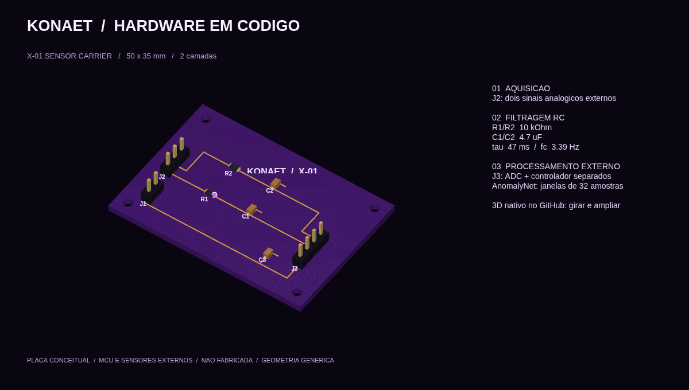
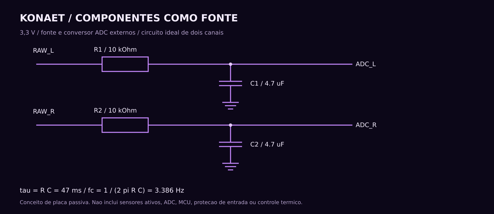
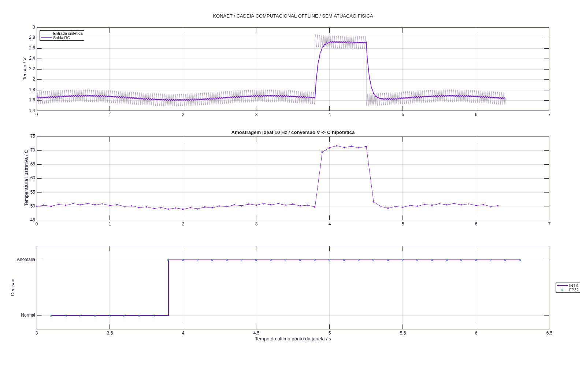
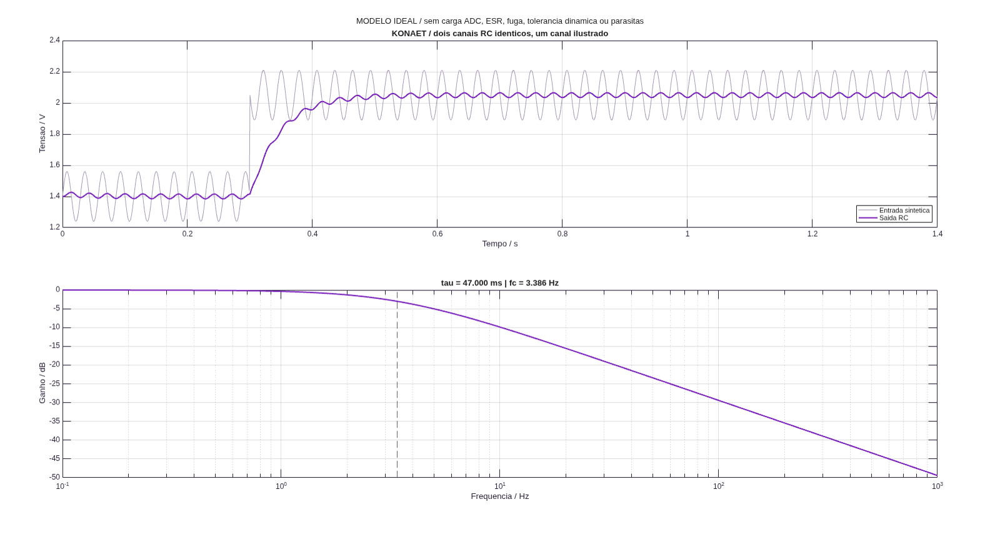
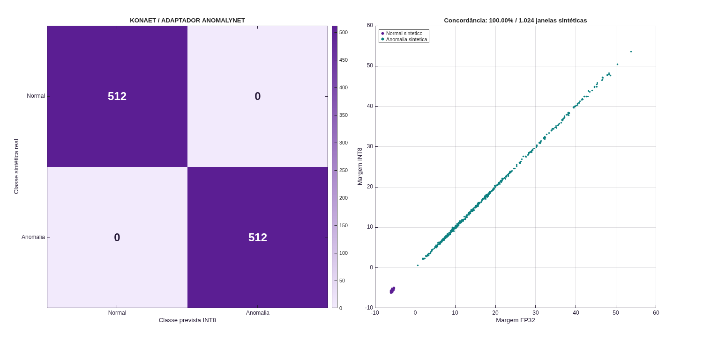

# KONAET / Sistema offline X-01

**[Explorar a placa em 3D](../hardware/x01-carrier/x01-carrier.stl)** · **[PCB para KiCad](../hardware/x01-carrier/x01-carrier.kicad_pcb)** · [Componentes na src](../src/board/x01_board.m) · [Testes e resultados](https://github.com/7dsolv/RealidadeQuantica/actions/workflows/offline.yml)

Componentes, conexões e geometria descritos em MATLAB geram uma placa de sensores conceitual, circuito RC, modelos 3D e desenhos. Um adaptador local executa o **AnomalyNet**, de **Eoin Jordan**, em FP32 ou INT8, e compara as decisões. A implementação não precisa acessar a rede para inferir.



O GIF ilustra o caminho do sinal; não é telemetria ao vivo. Abra o STL pelo link acima para girar, ampliar e inspecionar a geometria usando o visualizador nativo do GitHub. O repositório não contém uma interface HTML/JavaScript própria. A PCB e seus modelos locais também abrem no KiCad; use **Visualizar → Visualizador 3D**.

## Do componente ao detector



| Camada | Implementação disponível |
| --- | --- |
| Componentes | R1/R2 de 10 kΩ; C1/C2 de 4,7 µF; C3 de 100 nF; três conectores e quatro furos. |
| Circuito | Solução exata por intervalo para entrada constante, resposta em frequência e balanço de energia. |
| Placa | 50 × 35 mm, duas camadas, trilhas e pinos declarados em [`src/board/x01_board.m`](../src/board/x01_board.m). |
| Geometria | PCB nativa, modelos VRML locais e STL com envelopes genéricos dos componentes. |
| Inferência | 32 temperaturas → 24 neurônios ReLU → 2 logits; normalização `(T − 50)/20`. |
| Verificação | Vetor de referência do autor, comparação MATLAB/Fortran, quantização, entradas inválidas, RC e DRC do KiCad. |

Os sensores ativos, o ADC e o microcontrolador são **externos**. A placa não contém um processador executando IA. A simulação conecta RC → amostrador ideal de 10 Hz → conversão ilustrativa de tensão em temperatura → janela de 32 amostras → inferência. Não há calibração física dessa conversão nem acionamento de aquecimento.



## Cálculos elétricos

Para cada canal, com carga ideal de impedância infinita:

\[
RC\,\frac{dv_o}{dt}+v_o=v_i,\qquad
v_o(t+\Delta t)=v_i+[v_o(t)-v_i]e^{-\Delta t/(RC)}.
\]

\[
\tau=RC=47\text{ ms},\qquad f_c=\frac{1}{2\pi RC}\approx3{,}386\text{ Hz},\qquad
E_C=\frac12CV^2.
\]

O simulador integra também o trabalho da fonte e o calor no resistor e compara com a variação da energia do capacitor. As tolerâncias ilustrativas de 1% em R e 20% em C produzem `τ` de **37,224 a 56,964 ms**. Não modelamos carga/tempo de aquisição do ADC, ESR, fugas, redução de capacitância por polarização, parasitas ou proteção de entrada. Um filtro de primeira ordem não elimina aliasing por si só.



## Modelo, procedência e quantização

Os pesos são do [`eoinedge/AnomalyNet`](https://huggingface.co/eoinedge/AnomalyNet), revisão fixada em [`source.json`](../models/anomalynet/source.json). **Não foram treinados pela KONAET.** Mantemos [Apache-2.0](../models/anomalynet/LICENSE.txt), [atribuição](../models/anomalynet/NOTICE.txt) e hashes. Os quatro arquivos locais `.f32` preservam os bytes dos tensores originais; não executamos Python nem pickle para carregá-los.

Nossa quantização usa pesos e ativações INT8, biases/acumuladores INT32 e requantização inteira com multiplicador fixo. O payload contém **816 bytes de pesos + 104 bytes de biases = 920 bytes**; escalas, metadados, runtime, buffers e firmware ficam fora dessa conta. Isso não é o arquivo ExecuTorch publicado pelo autor.

Há 512 janelas sintéticas de calibração e **1.024 janelas de avaliação separadas**, com sementes distintas. Publicamos as duas matrizes de confusão e a concordância FP32/INT8, inclusive erros, sem substituir nossos resultados pela acurácia ou latência reportadas pelo autor. A faixa representável escolhida de aproximadamente 10–90 °C é apenas numérica; **não é um limite de segurança**. Entradas não finitas ou fora dessa faixa recebem classe `−1`, separada de “normal”.



Dados: [relatório Tiny](../assets/offline/tiny-report.json), [decisões pareadas](../assets/offline/tiny-predictions.csv), [cadeia de sinais](../assets/offline/signal-chain.json), [relatório RC/placa](../hardware/x01-carrier/board-report.json), [DRC nativo](../hardware/x01-carrier/kicad-report.json). A latência e a ocupação de RAM/flash em MCU permanecem **não medidas**. O resultado não demonstra um agente universal, consciência ou superioridade sobre outras IAs.

## Reproduzir

No MATLAB, na raiz deste repositório:

```matlab
executar_offline(false)
```

Isso usa os pesos já versionados e grava resultados em `artifacts/offline/`. Para a comparação independente, compile `fortran/tiny_anomalynet.f90` em `build/tiny_anomalynet` e rode `executar_offline(true)`. O [workflow](../.github/workflows/offline.yml) faz a compilação, os cálculos e a verificação da PCB com `kicad-cli`, sem publicar resultados de uma execução que falhou.

Inferência isolada, sem os gráficos:

```matlab
addpath('matlab/tiny')
m = tiny_load_model(pwd);
[logits, classe] = tiny_fp32(m, 50 * ones(32,1));
% 0 = normal; 1 = anomalia. Nao e uma funcao de controle de seguranca.
```

A execução local requer MATLAB; compilador e KiCad são necessários apenas para suas verificações respectivas. A placa não foi fabricada ou ensaiada. DRC verifica regras geométricas e conectividade; não certifica funcionamento elétrico, compatibilidade com um ADC específico, segurança ou prontidão para fabricação.

[Laboratório XENOELEMENT](../xeno/README.md) · [Laboratório principal](../README.md) · [KiCad CLI](https://docs.kicad.org/8.0/en/cli/cli.html) · [Visualizador STL do GitHub](https://docs.github.com/en/repositories/working-with-files/using-files/working-with-non-code-files#3d-file-viewer)
