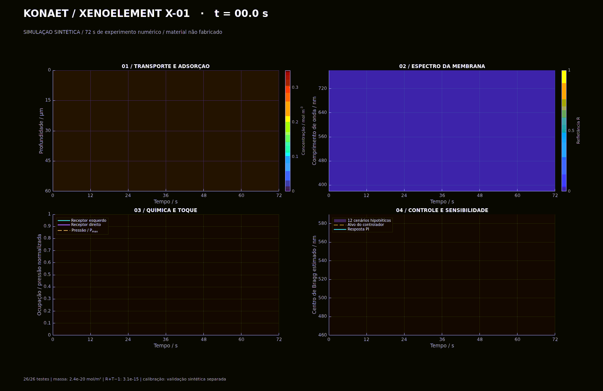
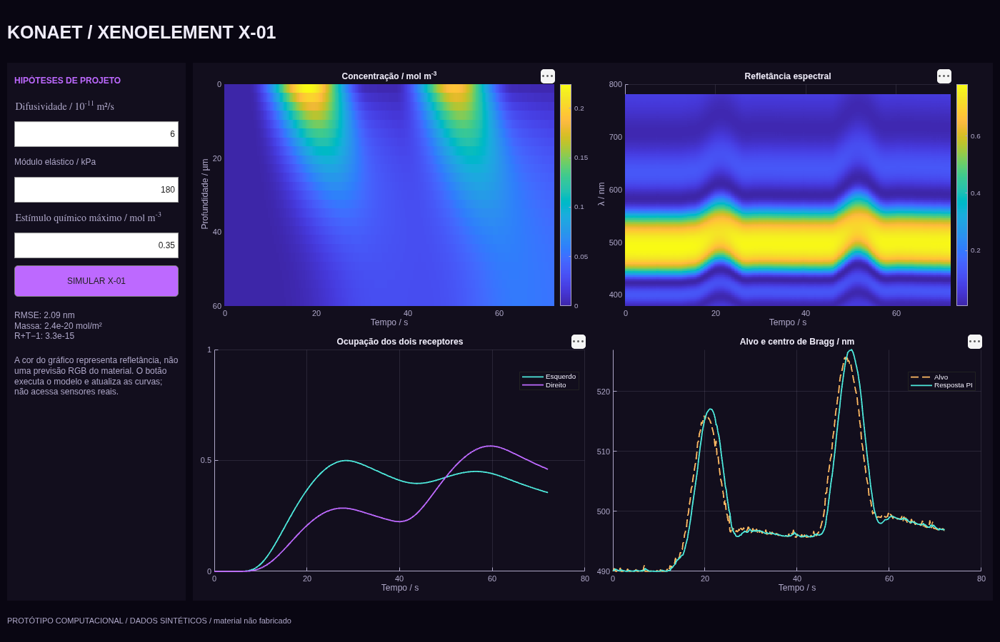
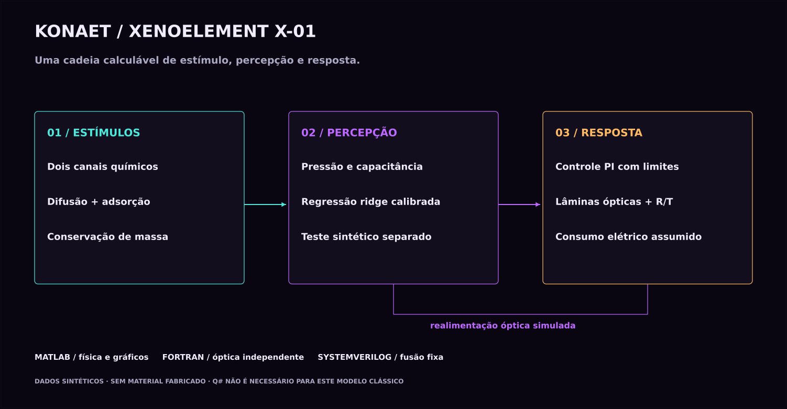
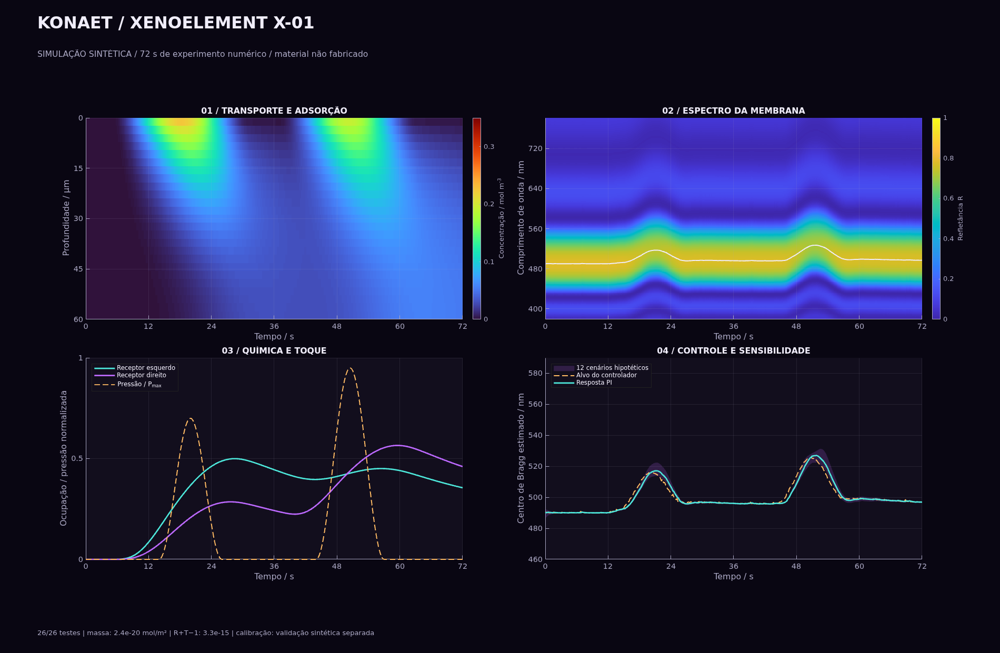

# KONAET XENOELEMENT X-01

**[Extensão offline: circuito, PCB 3D e AnomalyNet](../offline/README.md)**

**Membrana sensorial bioinspirada — protótipo computacional com dados sintéticos.**

Uma cadeia reproduzível que liga dois canais químicos, deformação mecânica, calibração estatística e resposta óptica. O modelo calcula uma hipótese de material; nenhum material foi fabricado e nenhuma proteína foi simulada em nível atômico.

[](https://github.com/7dsolv/RealidadeQuantica/actions/workflows/xenoelement.yml)



A animação reproduz 72 segundos de **tempo simulado**, comprimidos em 36 quadros. Ela não recebe sinais de sensores físicos nem executa cálculos no navegador. As cores dos mapas representam concentração e refletância; não são uma previsão RGB da aparência do material.

## Executar e explorar

No MATLAB R2025a ou mais recente, na raiz deste repositório:

```matlab
abrir_xenoelement
```

O app permite variar difusividade, módulo elástico e amplitude química, recalcular os modelos e comparar as curvas. A quinta aba de `abrir_laboratorio` abre o mesmo simulador. Os controles funcionam no MATLAB local.



```matlab
addpath('matlab/xeno')
evidence = executar_xeno(false, true);
```

Essa chamada testa o núcleo MATLAB, calcula os cenários e exporta gráficos e dados em `artifacts/xeno/`. O CI usa `executar_xeno(true,true)`: exige também a referência Fortran e a simulação SystemVerilog compiladas.

Na aba **Actions**, também é possível abrir **Konaet - ciclos autonomos do laboratorio → Run workflow** e selecionar `module: xeno`. O valor `physics` mantém os experimentos SU(3), onda e cosmologia.

## O que é calculado

| Bloco | Modelo e resultado |
| --- | --- |
| Dois canais químicos | Difusão 1D em 25 volumes por canal; entrada prescrita, fundo impermeável. |
| Receptores hipotéticos | Cinética de Langmuir com depleção da fase livre; o passo de reação conserva massa. |
| Percepção lateral | Contraste normalizado entre ocupações esquerda/direita, inspirado em amostragem bilateral. |
| Toque | Kelvin–Voigt sob compressão; capacitância com área fixa e espessura variável. |
| Calibração | Regressão ridge em 800 amostras sintéticas; 300 amostras independentes de validação. |
| Controle | PI com saturação e anti-windup; estima o centro de Bragg e comanda uma variável de atuação. |
| Óptica | Matriz de transferência de 12 camadas sem absorção, incidência normal, 201 comprimentos de onda. |
| Energia | Integral de uma carga elétrica resistiva hipotética; não é eficiência medida. |
| Sensibilidade | 12 cenários de difusividade, elasticidade e índice óptico; faixa de cenários, não intervalo de confiança experimental. |
| FPGA | Subbloco de fusão ponderada de 12 bits, com reset, valid e latência de um ciclo. |



As [equações, unidades e hipóteses](MODEL.md) permitem reconstruir cada etapa. Os parâmetros ficam em [`xeno_parameters.m`](../matlab/xeno/xeno_parameters.m) e são exportados para JSON em toda execução.

## Testes, gráficos e dados

O workflow **KONAET XENOELEMENT X-01** pode ser iniciado manualmente e roda diariamente às 05:43 UTC, sujeito ao agendamento do GitHub. Depois da validação, publica as imagens e evidências em `assets/xeno/`. Alterações locais nas hipóteses precisam ser enviadas ao repositório para aparecerem na apresentação pública.



O [relatório de testes](../assets/xeno/test-report.json) registra o nome e o resultado de cada caso. A [evidência numérica](../assets/xeno/evidence.json) e o [manifesto visual](../assets/xeno/visual-manifest.json) identificam a revisão de origem. Em **Actions → Artifacts → xenoelement-x01** ficam as trajetórias CSV, espectros R/T, dados de sensibilidade, parâmetros e o arquivo MATLAB completo `x01.mat`.

O comparativo `controller_comparison.csv` usa os mesmos 12 cenários, estímulos e ruído para o PI e para controle por antecipação sem realimentação. Publica erro **e energia** de ambos, inclusive cenários em que um controlador seja pior. Essa avaliação mede esta tarefa sintética; não compara agentes universais nem demonstra superioridade em ARC-AGI ou sobre outros sistemas de IA.

A [verificação da interface](../assets/xeno/app-report.json) constrói o app, exporta uma captura e altera os três controles antes de acionar o recálculo e conferir as saídas.

A validação cobre soluções analíticas, balanço de massa, positividade, balanço óptico, refinamento espacial/temporal, sementes reproduzíveis, calibração separada, controle limitado, comparação MATLAB/Fortran e a bancada SystemVerilog. Os testes verificam a implementação dessas hipóteses; não demonstram que um dispositivo físico terá o mesmo comportamento.

## Originalidade e próximos experimentos

O código e a composição dos gráficos foram desenvolvidos para este projeto, sem incorporar código ou imagens dos artigos citados. **Isso não demonstra que o conceito é inédito, patenteável ou livre de conflitos.** A [revisão inicial de antecedentes](PRIOR_ART.md) já identifica trabalhos relacionados e uma patente de filmes de reflectina.

O X-01 não especifica uma nova molécula, sequência genética ou processo de síntese. Os canais detectam um analito abstrato, não identificam substâncias reais. Os parâmetros precisam ser substituídos por medidas de difusão, ligação, deformação e elipsometria de um candidato físico antes de orientar fabricação.

Não é uma célula sintética, elemento químico, forma de vida ou evidência de consciência. A regressão deste núcleo físico é uma calibração numérica restrita, sem pesos importados. A extensão [offline](../offline/README.md) usa separadamente os pesos AnomalyNet de Eoin Jordan, com atribuição Apache-2.0. Este módulo é clássico; Q# permanece no experimento Ramsey separado, pois o X-01 não demonstra vantagem de computação quântica.

[Laboratório principal](../README.md) · [Modelo matemático](MODEL.md) · [Resultados](RESULTS.md) · [Fontes e antecedentes](PRIOR_ART.md) · [Plano de validação física](VALIDATION_PLAN.md)
